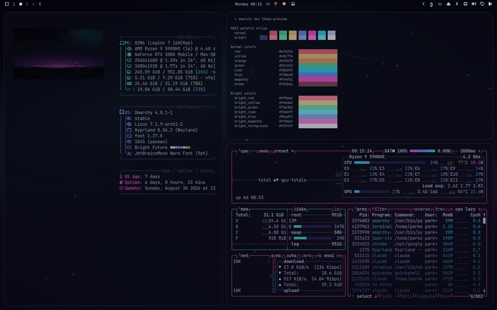
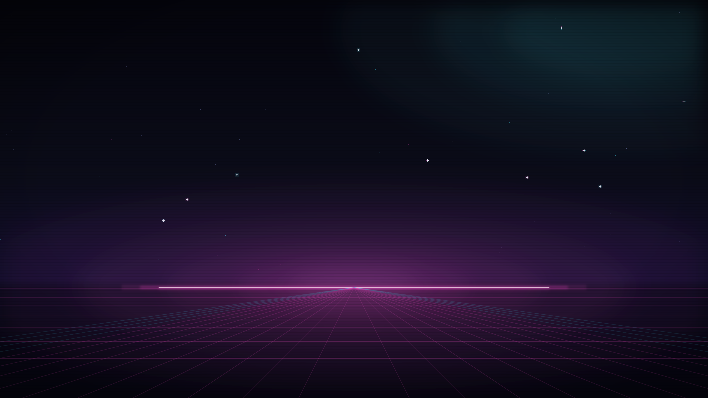
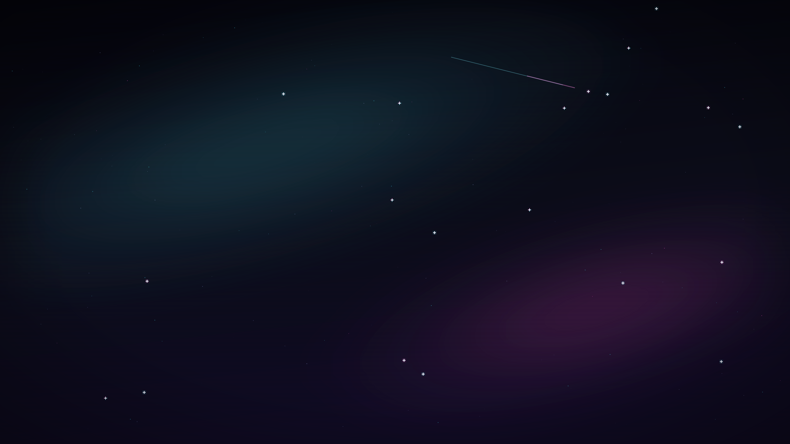

# Bright Future

An Omarchy theme. Dark-space duotone: a near-black indigo ground, one hot
magenta signal, one electric cyan depth. About 90% of every surface stays
dark — the two accents behave like coloured light sources, not paint.



The capture is real and reproducible: `bin/shoot-terminals` stages fastfetch,
the omarchy palette preview and btop on a spare workspace, shoots the monitor,
and derives `preview.png` from the same frame.

## Install

```
omarchy theme install https://github.com/parker-brown-family/omarchy-bright-future-theme
```

Omarchy names it `bright-future` and applies it on install. Later:

```
omarchy theme set bright-future
```

This is a colours-only theme, the shape Omarchy 4 expects from installed
repos: terminal, btop, Hyprland, the generated Neovim/Helix/VS Code schemes,
lock screen and keyboard backlight all derive from [`colors.toml`](colors.toml)
through Omarchy's own templates. Active window borders run a magenta→cyan
gradient at 45° — the one place both accents meet.

## Palette

| Role | Hex | Where it lands |
|---|---|---|
| Signal — accent A | `#ff4fd1` | accent, magenta, active-border start, keyboard backlight |
| Depth — accent B | `#45e5ff` | active-border end; cyan family `#38d2f5` / `#7deeff` |
| Ground | `#0b0c19` | background, with `#04040b` → `#151735` shades |
| Material | `#221f4e` / `#414780` | selection, muted lines, inactive borders |
| Text | `#c8d0f4` | foreground, from `#6b74a8` dim to `#f2f4ff` bright |

The full ANSI set lives in [`colors.toml`](colors.toml). The rules this
instance was cut from — role definitions, the 90/10 chroma budget, hue
separation, cross-pollination ratios — are in [`PALETTE.md`](PALETTE.md),
together with how to derive a sibling palette.

## Backgrounds

Two 4K wallpapers, drawn from nothing by
[`backgrounds/src/render.sh`](backgrounds/src/render.sh) (bash emits SVG,
librsvg rasterises, ImageMagick derives the preview/unlock stills). No sourced
art. *Bright horizon* is the dawn line and grid; *deep field* is a starfield
with a two-hue drift for a quieter second cycle. Rendered PNGs are committed —
rerun the script only to change the art (needs librsvg and ImageMagick).





## License

MIT
